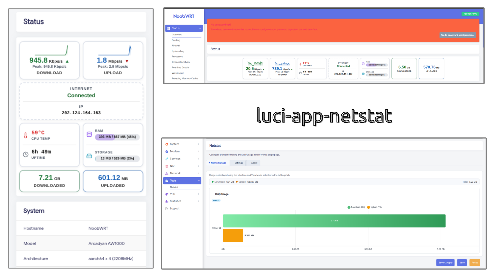
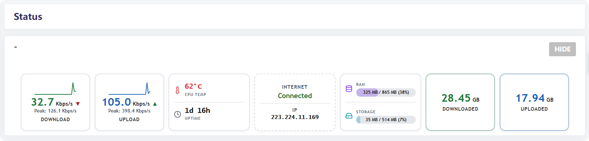
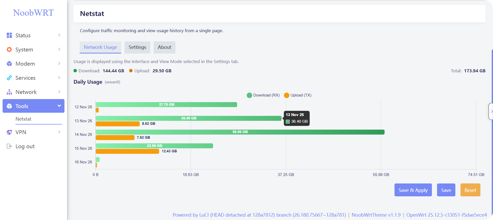
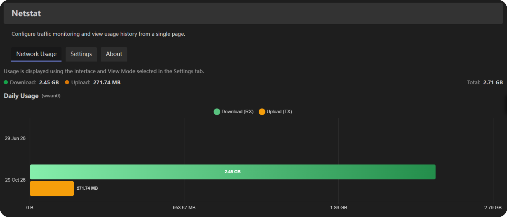
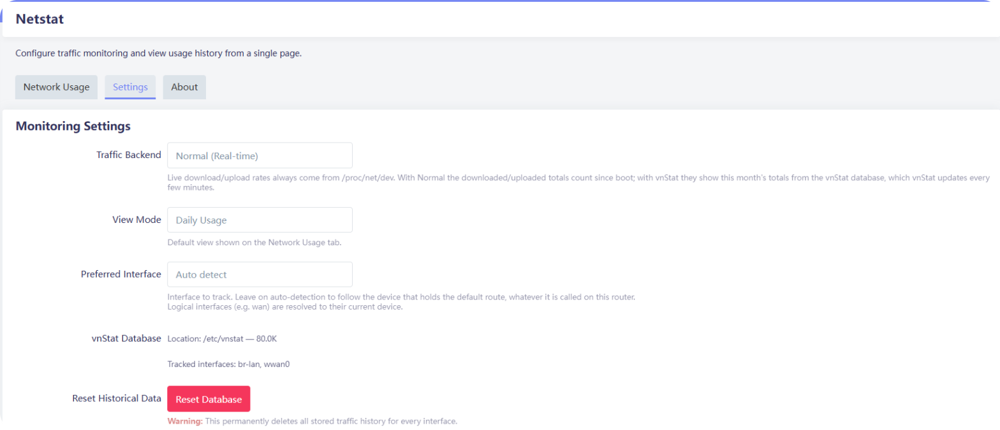

<div align="center">



# luci-app-netstat

**Live traffic rates and usage history for any OpenWrt router, right inside LuCI.**

[](https://github.com/nooblk-98/luci-app-netstat/releases/latest)
[](https://github.com/nooblk-98/luci-app-netstat/releases)
[](https://openwrt.org)
[](Makefile)

[Features](#features) • [Screenshots](#screenshots) • [Installation](#installation) • [Usage](#usage) • [Settings](#settings) • [Troubleshooting](#troubleshooting)

</div>

luci-app-netstat adds a live traffic dashboard to the LuCI **Status** page and a **Netstat** page with daily and monthly usage charts. It works on any OpenWrt router: it finds your internet connection automatically and starts recording usage history without any setup.

## Features

- **Live dashboard** on Status → Overview, refreshed every two seconds:
  - download and upload speed with sparklines, peaks and trend arrows
  - total downloaded and uploaded
  - internet status and public IP, including through Passwall or another proxy
  - CPU temperature, uptime, RAM and storage
  - phone port status on routers with an RJ11 phone port (AW1000 with fxsd): on, off, ringing or in call
- **Usage history:** daily or monthly download and upload charts per interface, powered by [vnStat 2](https://humdi.net/vnstat/).
- **Automatic detection:** follows whatever connection holds the default route (PPPoE, DHCP, LTE/5G modem, VPN), or the interface you pick.
- **No setup needed:** interfaces are added to usage tracking as they come up.
- **Matches your theme** in light and dark mode, including live switching.
- **Lightweight:** one small package that works on every router architecture.

## Screenshots



<table>
  <tr>
    <td width="50%"></td>
    <td width="50%"></td>
  </tr>
  <tr>
    <td align="center">Usage history, light mode</td>
    <td align="center">Usage history, dark mode</td>
  </tr>
</table>

## Installation

**Requirements:** OpenWrt **24.10** or **25.x** with LuCI. vnStat 2 (`vnstat2`) is installed automatically.

1. Download the package for your OpenWrt version from the [latest release](https://github.com/nooblk-98/luci-app-netstat/releases/latest):
   - OpenWrt **25.x**: the `.apk` file
   - OpenWrt **24.10**: the `.ipk` file
2. Copy it to the router (for example to `/tmp`) and install it:

   ```bash
   # OpenWrt 25.x
   apk update
   apk add --allow-untrusted /tmp/luci-app-netstat-*.apk

   # OpenWrt 24.10
   opkg update
   opkg install /tmp/luci-app-netstat_*_all.ipk
   ```

3. Reload LuCI in your browser. The dashboard appears on **Status → Overview**.

> [!IMPORTANT]
> **Upgrading from 1.1.x?** That version used vnStat 1.x. Remove both packages first, then install the new package as above:
>
> ```bash
> /etc/init.d/vnstat stop
> apk del luci-app-netstat vnstat       # or: opkg remove luci-app-netstat vnstat
> ```
>
> To keep your old history, set `DatabaseDir` in `/etc/vnstat.conf` to the folder that holds the old files (often `/etc/vnstat`) **before** vnStat 2 starts for the first time. It imports them automatically.

## Usage

**Status → Overview** shows the live dashboard. Use **Hide** to collapse it.

**Tools → Netstat** has three tabs:

| Tab | What it shows |
|---|---|
| **Network Usage** | Daily or monthly download and upload for the tracked interface, with totals |
| **Settings** | What to track and how totals are counted, plus the usage database and a reset button |
| **About** | Project links, licence and support |

## Settings



| Setting | Default | What it does |
|---|---|---|
| **Traffic Backend** | Normal | *Normal* counts the dashboard's downloaded/uploaded totals since boot. *vnStat* shows this month's totals instead. Live speeds are always real time. |
| **View Mode** | Daily | Whether the Network Usage tab opens on daily or monthly usage. |
| **Preferred Interface** | Auto detect | The interface to track. Auto follows your internet connection; you can pick a device (`eth1`) or a network (`wan`). |

The same settings can be changed from the command line through `/etc/config/netstats`:

```bash
uci set netstats.@config[0].backend='vnstat'   # or 'normal'
uci commit netstats
```

## Troubleshooting

> [!WARNING]
> By default OpenWrt keeps vnStat's database in RAM (`/var/lib/vnstat`), so **usage history is lost on every reboot**. Set `DatabaseDir` in `/etc/vnstat.conf` to permanent storage, such as `/etc/vnstat` or a USB disk to spare the flash, then run `service vnstat restart`. The Settings tab shows where the database is now.

**"No data available" on the Network Usage tab**
vnStat saves usage every few minutes, so a newly tracked interface takes a short while to show data. You can list the tracked interfaces with `vnstat --dbiflist 1`.

**The dashboard looks the same after an upgrade**
Your browser is still using the old cached files. Clear the cache for the router's address, or open LuCI in a private window.

**The IP card shows a private address**
That's your router's local WAN address. It's shown until the public IP lookup succeeds, which needs internet access from the router itself. With Passwall, enable *localhost proxy* to see the proxied IP.

**Something else?**
Open an [issue](https://github.com/nooblk-98/luci-app-netstat/issues) with your OpenWrt version and a screenshot.

## Credits

Originally created by [SMALLPROGRAM](https://github.com/smallprogram), maintained by [nooblk-98](https://github.com/nooblk-98).
