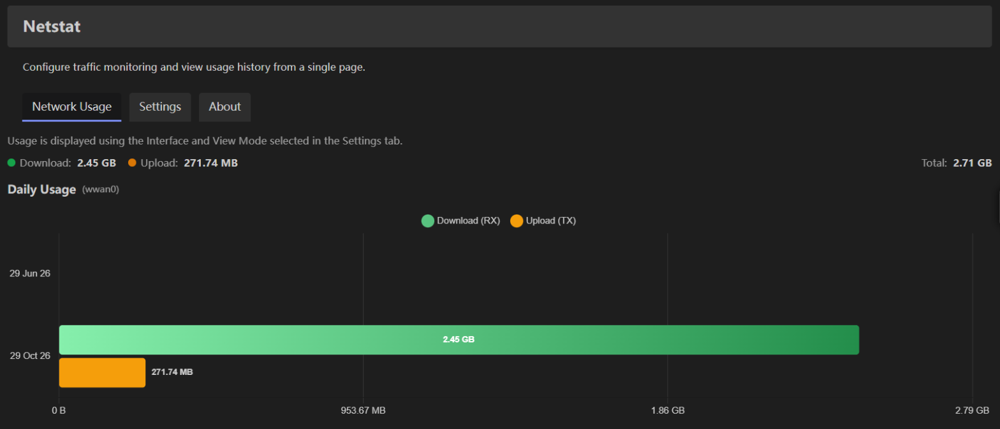
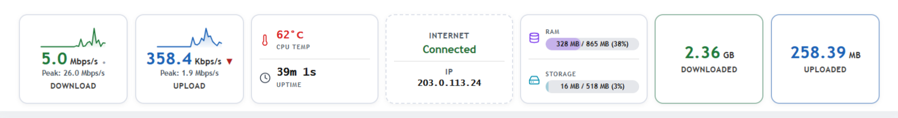
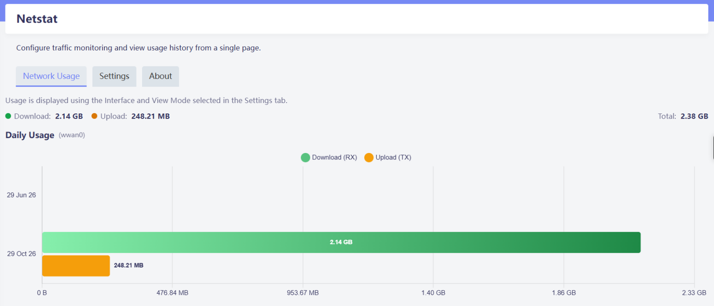
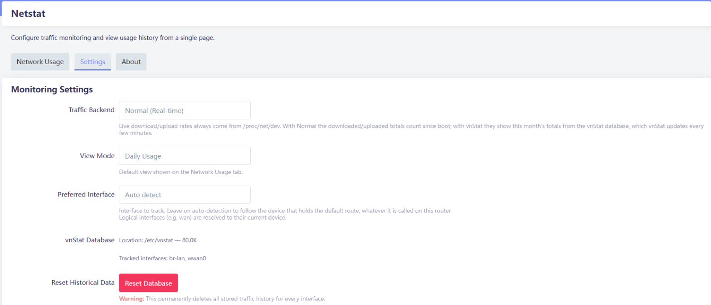

<div align="center">

# luci-app-netstat

**Live traffic rates and vnStat usage history for any OpenWrt router, in LuCI.**

[](https://github.com/nooblk-98/luci-app-netstat/releases/latest)
[](https://github.com/nooblk-98/luci-app-netstat/actions/workflows/build.yml)
[](https://openwrt.org)
[](https://humdi.net/vnstat/)
[](Makefile)

[Features](#features) • [Installation](#installation) • [Usage](#usage) • [Configuration](#configuration) • [How it works](#how-it-works) • [Troubleshooting](#troubleshooting)



</div>

luci-app-netstat adds a live traffic dashboard to the LuCI status page and a **Netstat** page with daily and monthly usage charts. Live rates come straight from the kernel, and history comes from [vnStat 2](https://humdi.net/vnstat/).

It works on any OpenWrt router: there are no hard-coded interface names, device paths or board-specific files. The uplink is found from the routing table, and vnStat is set up to track your interfaces automatically.

## Features

- **Live dashboard on Status → Overview:**
  - download and upload rates with sparklines, peaks and trend arrows;
  - total downloaded and uploaded;
  - internet status and public IP, as seen through Passwall or any other proxy;
  - CPU temperature, uptime, RAM and storage.
- **Usage history:** daily or monthly charts per interface, read from `vnstat --json`.
- **Automatic interface detection:** follows the device that holds the default route (PPPoE, DHCP, LTE/5G modems, VPNs, DSA ports), or the interface you choose.
- **Zero-config vnStat:** interfaces are added to vnStat as they come up, so there is nothing to set up by hand.
- **Follows your theme:** uses LuCI's standard sections and tabs, so it matches any theme in light or dark mode, including live switching.
- **Lightweight:** shell, Lua and plain JavaScript only; packages are architecture-independent.

## Installation

### Requirements

- OpenWrt **24.10** or **25.x** with LuCI
- **`vnstat2`** (vnStat 2.x): installed automatically as a dependency. The old vnStat 1.x `vnstat` package is not supported.

### From a release

Download the package for your OpenWrt version from the [latest release](https://github.com/nooblk-98/luci-app-netstat/releases/latest), copy it to the router and install it:

```bash
# OpenWrt 25.x (apk)
apk update
apk add --allow-untrusted luci-app-netstat-*.apk

# OpenWrt 24.10 (opkg)
opkg update
opkg install luci-app-netstat_*_all.ipk
```

### Build from source

Add the package to an OpenWrt buildroot or SDK that has the `luci` and `packages` feeds:

```bash
git clone https://github.com/nooblk-98/luci-app-netstat.git package/luci-app-netstat
make menuconfig   # LuCI → Applications → luci-app-netstat
make package/luci-app-netstat/compile
```

> [!IMPORTANT]
> **Upgrading from 1.1.x?** That version used vnStat 1.x. Remove both packages, install `vnstat2`, then install the new package:
>
> ```bash
> /etc/init.d/vnstat stop
> apk del luci-app-netstat vnstat       # or: opkg remove luci-app-netstat vnstat
> ```
>
> To keep your history, set `DatabaseDir` in `/etc/vnstat.conf` to the folder that holds your old 1.x files (often `/etc/vnstat`) **before** vnStat 2 starts. It imports them on first start.

## Usage

### Live dashboard

Open **Status → Overview**. The Netstat widget refreshes every two seconds.



### Usage history

Open **Tools → Netstat**:

| Tab | What it shows |
|---|---|
| **Network Usage** | Daily or monthly download/upload for the tracked interface, with totals |
| **Settings** | Traffic backend, default view, interface, vnStat database info and reset |
| **About** | Project links, licence and support |

<table>
  <tr>
    <td></td>
    <td></td>
  </tr>
</table>

## Configuration

Settings live in `/etc/config/netstats` and can be changed from the **Settings** tab:

| Option | Default | Description |
|---|---|---|
| `prefer` | `''` | Interface to track. Empty means auto (the default-route device). Accepts a device (`eth1`) or a logical interface (`wan`). |
| `backend` | `normal` | Downloaded/uploaded totals on the dashboard: `normal` counts since boot; `vnstat` shows this month from vnStat. Live rates always come from `/proc/net/dev`. |
| `mode` | `daily` | Default view on the Network Usage tab: `daily` or `monthly`. |
| `vnstat_autoadd` | `1` | Set to `0` to stop the app from adding interfaces to vnStat. |

```bash
uci set netstats.@config[0].backend='vnstat'
uci commit netstats
```

## How it works

| Piece | Source |
|---|---|
| Live rates and since-boot totals | `/proc/net/dev` |
| Uplink detection | `/proc/net/route` and `/proc/net/ipv6_route`; logical names resolved through `ubus` (netifd) |
| History and monthly totals | `vnstat --json` and `vnstat --dbiflist` |
| Public IP | `api.ipify.org` via `curl` or `uclient-fetch`, refreshed every 5 minutes |

OpenWrt starts `vnstatd` with `--noadd`, so out of the box it tracks only the interfaces listed in `/etc/config/vnstat`. This package fills that list for you:

- `/etc/hotplug.d/iface/90-netstat-vnstat` adds each interface's device when it comes up.
- `/etc/uci-defaults/50_luci-netstat` does the same once at install for interfaces that are already up.
- You can run `/usr/libexec/netstat-vnstat-track` by hand at any time.

## Troubleshooting

**"No data available" on the Network Usage tab**
vnStat writes to its database every few minutes, so a newly tracked interface takes a short while to show data. Check what is tracked with `vnstat --dbiflist 1`.

> [!WARNING]
> OpenWrt's default vnStat database location, `/var/lib/vnstat`, is in RAM, so **history is lost on every reboot**. Set `DatabaseDir` in `/etc/vnstat.conf` to persistent storage (for example `/etc/vnstat`, or a USB disk to avoid flash wear), then run `service vnstat restart`. The Settings tab shows the current location.

**The dashboard still looks or behaves like the old version after an upgrade**
LuCI caches view scripts in the browser until LuCI itself is updated. Clear the browser cache for the router, or open the page in a private window.

**The IP card shows a private address**
This is the WAN device's local address, shown until the public-IP lookup succeeds. The lookup needs internet access from the router itself; with Passwall, enable *localhost proxy* to see the proxied IP.

## Credits

Originally created by [SMALLPROGRAM](https://github.com/smallprogram); maintained by [nooblk-98](https://github.com/nooblk-98). Bug reports and ideas are welcome in [Issues](https://github.com/nooblk-98/luci-app-netstat/issues).
