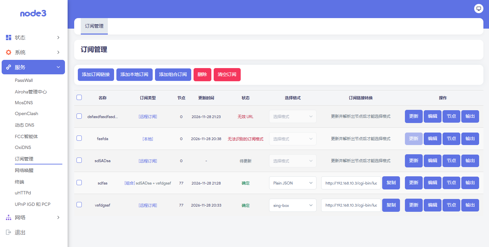

# luci-app-substore

**English** | [简体中文](README.md)

Native **OpenWrt / ImmortalWrt** LuCI application for managing airport / proxy
subscriptions. Parse nodes from a subscription, filter, deduplicate, rename and
group them, then re-emit them in a format your client can consume.



## Installation

> The version in the package name must match `PKG_VERSION` / `PKG_RELEASE` in the
> [Makefile](Makefile) (currently `2.9.0-r1`).

**Minimum supported: OpenWrt / ImmortalWrt 24.10** (older releases are out of scope).
The backend is pure ucode since 2.8.0 and no longer depends on the Lua runtime.

opkg (OpenWrt / ImmortalWrt 24.10):

```bash
opkg install luci-app-substore_*.ipk
# Simplified Chinese UI needs the translation package as well
opkg install luci-i18n-substore-zh-cn_*.ipk
```

OpenWrt 25.12 and newer (apk):

```bash
apk add --allow-untrusted luci-app-substore-*.apk
# Simplified Chinese UI needs the translation package as well
apk add --allow-untrusted luci-i18n-substore-zh-cn-*.apk
```

> The main package ships no translations, so the UI stays English without the
> translation package. Its version comes from the `po/` commit time (LuCI's
> `PKG_PO_VERSION`), so it does not share the main package's version; install it by
> filename wildcard. Set the LuCI language to Simplified Chinese afterwards — the
> package's uci-defaults adds it to `luci.languages` automatically.

Then open LuCI: **Services → Subscriptions**.

### Building from source

In an OpenWrt / ImmortalWrt source tree matching the target firmware:

```sh
cd openwrt
./scripts/feeds update -a
./scripts/feeds install -a
git clone https://github.com/Arthur97172/luci-app-substore.git package/luci-app-substore
make menuconfig   # LuCI → Applications → luci-app-substore
make package/luci-app-substore/compile V=s
```

The Simplified Chinese package `luci-i18n-substore-zh-cn` is generated by `luci.mk`
from `po/zh_Hans/` and lives in the same `package/luci-app-substore` directory, so the
same `compile` command produces it. It is a HIDDEN package (no Kconfig prompt), though,
so enable its language symbol before building or it will not be selected:

```sh
echo "CONFIG_LUCI_LANG_zh_Hans=y" >> .config
make defconfig
```

> Note that `make package/luci-i18n-substore-zh-cn/compile` is **not a valid target** —
> make targets are per directory, not per package name.

The `.ipk` (or `.apk` on apk builds) is produced under `bin/packages/.../`; install
it as described above.

## Features

**Subscription management**
- Add / edit / delete / update multiple subscription sources, with manual and
  per-subscription scheduled (cron) updates; an overview shows node counts, last
  update time and error messages
- **Batch delete**: tick one or more subscriptions (the header checkbox selects
  all) and hit Delete to remove them in one go; with nothing ticked, Delete
  removes nothing. Rows no longer carry their own Delete button — to remove a
  single subscription, tick it and hit Delete at the top
- **Clear subscriptions**: the button next to Delete removes every subscription
  and its node data after a confirmation (cron entries and combination sources
  are cleaned up too); it is disabled while the list is empty
- Remaining traffic / expiry per subscription (parsed from the `subscription-userinfo`
  response header)
- **Subscription proxy**: fetch through `http` / `https` / `socks4` / `socks5` /
  `socks5h`, for sources that cannot be reached directly
- **Subscription client type**: the `User-Agent` sent when fetching, set per
  subscription, with Clash Verge / v2rayN / Clash Party / FlClash presets and a
  custom value (the raw `User-Agent` header to send verbatim, e.g.
  `clash-verge/v2.5.0`; at most 256 chars, no control characters).
  Some providers hand out nodes by UA — the same link only yields the
  real nodes for its bound client; a wrong UA returns a "client incompatible"
  placeholder (which still parses, but is nothing but fake `127.0.0.1:1080` nodes)
- **Combined subscriptions**: merge any subset of existing subscriptions into a new
  one with its own name, token and link; it is recomputed when a source updates or
  is **deleted** (the dead id is pruned from its sources; deleting every source
  reports an error instead of silently becoming a 0-node combo)
- **Local subscriptions**: paste node text directly (one format at a time,
  auto-detected) instead of providing a URL, or enter nodes field by field

**Input parsing**
- Formats: URI list, Base64, JSON, Clash YAML, sing-box JSON, V2Ray / Xray JSON,
  Surge / Surfboard / Loon / Quantumult X configs, wg-quick / AmneziaWG `.conf`
- Protocols: `vmess` / `vless` / `trojan` / `shadowsocks` / `ssr` / `hysteria` /
  `hysteria2` / `tuic` / `wireguard` / `socks`
  (`http` can be imported and exported, but is not offered in the node form)
- **WireGuard / AmneziaWG**: all fields plus the `amnezia-wg-option` block; an
  AmneziaWG client `.conf` can be pasted as-is
- **Tolerant parsing**: nodes missing `server`, or with a port outside 1–65535, are
  dropped during parsing — otherwise they would be written into a config the client
  refuses to load, and one bad node would break the whole subscription

**Node handling**
- Filter by group / protocol, keyword search, sorting; a node's group is editable
  directly in the table (saved over XHR)
- Edit / delete a single node, or select several and delete them in bulk
- Per-subscription rules: keyword include / exclude, protocol filter, dedup, and
  rename (exact match / regex / placeholder template)

**Network probing** (nodes page)
- Ping (ICMP), TCPing (TCP connect) and URL test (HTTP), run in parallel with a
  success count and average latency. All three probe the node server **directly
  from the router**, which is not the same metric as the through-proxy delay
  Clash Verge / OpenClash shows (an HTTP request through the proxy to
  `generate_204`), so the numbers are not directly comparable; placeholder nodes
  on `127.0.0.1` are always reported as failed (a local probe would otherwise
  "succeed" and make fake nodes look fastest)

**Conversion & output**
- 15 output formats: Plain JSON, Stash, Clash.Meta / Mihomo, Clash (original),
  Surfboard, Surge, Surge Mac, Loon, Egern, Shadowrocket, Quantumult X, sing-box,
  V2Ray / Xray, V2Ray URI, WireGuard / AmneziaWG `.conf`
- SSR (`ssr://`) can only be emitted to clients that support it (Mihomo, Stash, Loon,
  Shadowrocket); other targets drop it. VLESS works the same way: Surge / Surfboard /
  Surge Mac do not list it among their protocols (see `FAMILY_CAPS` in
  `output_formats.uc` for the Surge family and Loon; Egern's config is YAML and its
  list lives in `EGERN_KEY` in `output_egern.uc` — it has VLESS and WireGuard but
  neither SSR nor Hysteria v1)
- **Only content the target client can actually load is emitted**: protocols are
  filtered by target capability, array-valued fields use the type the client expects,
  and proxy-group member lists drop node names that would break their syntax
- sing-box / V2Ray(Xray) output is a **complete working config** (including routing),
  usable as a single-file config

**Subscription links**
- A random per-subscription token backs the public download endpoint
  `/substore/download?token=<token>&target=<format>`, so Passwall / OpenClash can
  pull it directly
- The format dropdown on the list page stays greyed out until the subscription has
  actually parsed some nodes (just added, update failed, or node count 0), so you
  cannot generate a subscription link that is bound to be empty

**LuCI interface & i18n**
- The backend is pure ucode (controller / templates / core modules), matching
  upstream LuCI's runtime
- Follows the LuCI light / dark theme automatically, with no manual switch; adapted
  to luci-theme-bootstrap (the 24.10 / 25.12 default) and luci-theme-argon 2.x / 3.x —
  colours come from theme CSS variables first, with light/dark-aware fallbacks, so no
  single palette is hardcoded
- English by default, Simplified Chinese when the runtime language is `zh-cn`

## Usage

1. **Add a subscription** — paste the subscription URL; optionally set up a
   per-subscription cron schedule, rules, or a download proxy. No remote source?
   Use **Add local subscription**: paste node text or enter nodes via the form.
2. **Update** — fetch, parse and filter the nodes.
3. **Browse nodes** — filter (group / protocol / keyword), sort, probe latency; tick
   checkboxes and hit Delete for batch deletion, edit / delete / regroup in-row, and
   Refresh reloads the list.
4. **Export** — pick one of the 15 output formats, or copy the subscription link
   to feed a downstream client (Passwall / OpenClash / …).

> **Rename rules use POSIX extended regular expressions (ERE), not PCRE.**
> `|` means "or" both at the top level and inside groups, so `a|b` and `(a|b)`
> are equivalent; `\d` / `\w` / `\s` are translated to the matching character
> classes. ERE has no non-greedy quantifiers, so `.*?` behaves as greedy `.*`
> (no error); `\b` is ignored; PCRE constructs such as lookaround fail to compile
> and are rejected on save with the line number.
> A `|` inside a character class `[...]` is still literal.

## Known limitations

Each of these is a **code-audit-confirmed** limitation kept deliberately, not an
oversight.

- **Mixed-format text import is rejected** — pasted node text may contain only one
  format at a time (URI / Base64 / YAML / JSON / WireGuard `.conf`); protocols may
  be mixed *within* that format. Mixing formats fails with an explicit error naming
  the formats found, instead of silently dropping part of the input.
  **Remote subscriptions are not affected**: mixed content there is still resolved
  by priority to a single format (unchanged historical behaviour).
- **hysteria v1 exported to sing-box needs `up` / `down` (bandwidth) added by hand** —
  the node model carries no bandwidth field, and inventing a default would be a guess.
- **hysteria v1 URIs are only guaranteed round-trip faithful** (this package's export →
  this package's import) — the upstream URI spec could not be verified (its docs site
  has been 404ing), so unrecognised query parameters are ignored rather than
  given an invented meaning.
- **`http` cannot be created by hand in the UI** — it is absent from the authoritative
  protocol list, so the form does not offer it; it can still be imported from
  Clash / JSON configs and exported normally.
- **AmneziaWG options are a single JSON text box** in the UI (`amnezia-wg-option`) —
  the data round-trips correctly, but has to be written as JSON by hand.
- **On the wget backend, size and redirect checks happen *after* the request is sent** —
  busybox wget has no equivalent of `--max-filesize` / `--max-redirect`. An oversized
  response is **discarded and reported as an error** (it never reaches the parser), and
  every redirect hop is **re-checked** with any private/reserved hop rejecting the whole
  download; the only difference is that both checks land after the request went out.
  **Installing curl avoids this entirely** (the curl path uses `--max-filesize` and
  `--max-redirs 0` to stop before sending).
- **On a box with no DNS resolution capability at all, the wget backend refuses to
  download domain subscriptions** — pre-flight validation cannot check the target there,
  and wget lacks curl's `%{remote_ip}` for a post-connect re-check, so it refuses rather
  than allowing an unverifiable target (the error suggests installing curl). Literal IP
  targets and boxes that do have a resolver are unaffected.

## Project layout

```
.
├── Makefile                      # OpenWrt package definition
├── LICENSE                       # GPL-3.0-or-later
├── root/                         # install payload
│   ├── etc/
│   │   ├── config/substore       # UCI placeholder
│   │   └── uci-defaults/99-substore
│   ├── usr/
│   │   ├── bin/substore-cron.sh  # per-subscription cron runner (inline ucode)
│   │   └── share/
│   │       ├── ucode/
│   │       │   ├── luci/controller/admin/substore.uc  # LuCI ucode controller
│   │       │   ├── luci/template/substore/*.ut        # page templates
│   │       │   └── substore/*.uc                      # core logic (no luci.* dependency)
│   │       ├── luci/menu.d/luci-app-substore.json
│   │       └── rpcd/acl.d/luci-app-substore.json  # ACL group (referenced by menu depends.acl)
│   └── www/luci-static/resources/substore/nodeform.js # node form frontend script
└── po/zh_Hans/substore.po        # Simplified Chinese (built as the separate luci-i18n-substore-zh-cn package)
```

## Changelog

- [CHANGELOG.md](CHANGELOG.md) — changelog

Design and testing documents are kept in the local development tree only; they are
not published to the repository and neither building nor installing depends on them.

## Development & testing

The core is a set of ucode modules (`root/usr/share/ucode/substore/*.uc`) with no
`luci.*` dependency; they load directly under `ucode` on a device, and the cron
runner uses the same entry point. The repository ships no test directory. Verify on
a device with:

```sh
# syntax checks: modules & controller, templates
ucode -c -s /usr/share/ucode/substore/*.uc
ucode -T -c /usr/share/ucode/luci/template/substore/*.ut
# cron main loop (updates every enabled subscription)
/usr/bin/substore-cron.sh
```

Feature testing is done page by page on the target device: subscription CRUD,
update/parse, node filter/edit/probe, 15 output formats, subscription-link pull,
cron.

## Security

SSRF protection (private / reserved / link-local ranges rejected; a hostname that
**fails to resolve is rejected** when a resolver is available, so "unresolvable ⇒ pass"
is not a bypass; every redirect hop is re-checked), protocol whitelisting and port range
validation (1–65535), response size & timeout limits, download temp files removed on
every exit path (`/tmp` is a tmpfs), command-injection defence (whitelisted parsing +
shell quoting, plus probe targets starting with `-` rejected — busybox `getopt` would
read them as options), token-based access control on the public download endpoint, and
no credentials in logs.

**On a box with no DNS resolver** (no `nslookup` available), domain targets cannot
be validated before the request; the curl backend then re-checks the actual peer address
via `%{remote_ip}` **after connecting** (which also closes the DNS-rebinding TOCTOU
window), while the wget backend has no equivalent and **refuses** instead of allowing it
(see "Known limitations").

**Form submission validation**: write actions require a `token` that is present and
non-empty, and — when available — equal to LuCI's `context.authtoken` (the very value
the framework's templates put in `token`); a failure is **reported back** rather than
silently dropped. **Access control**: the `luci-app-substore` ACL group takes effect
through `menu.d`'s `depends.acl` — unauthorised LuCI users do not see the app, and
**direct URL access is refused with 403** (the ucode dispatcher validates the
`depends.acl` accumulated along the request path at dispatch time; verified against
upstream source **and measured on a device**). To grant access, add the user to the
`luci-app-substore` ACL group (defined in
`root/usr/share/rpcd/acl.d/luci-app-substore.json`).

Data on disk: `/etc/substore` is `0700`, and `subscriptions.json` / `nodes/*.json`
are `0600` — the former holds subscription URLs and public download tokens, the
latter uuid / passwords / private keys. Files are created per the umask
(typically 0644), readable by any local user, so `atomic_write` tightens the mode
explicitly after each write.

Batch node probing is capped at 16 concurrent processes (`probe.MAX_PARALLEL`):
the node count comes from subscription content, and unbounded concurrency exhausts
the router's fd / process budget, after which `popen` fails silently.

## License

[GPL-3.0-or-later](LICENSE) — see the [LICENSE](LICENSE) file.