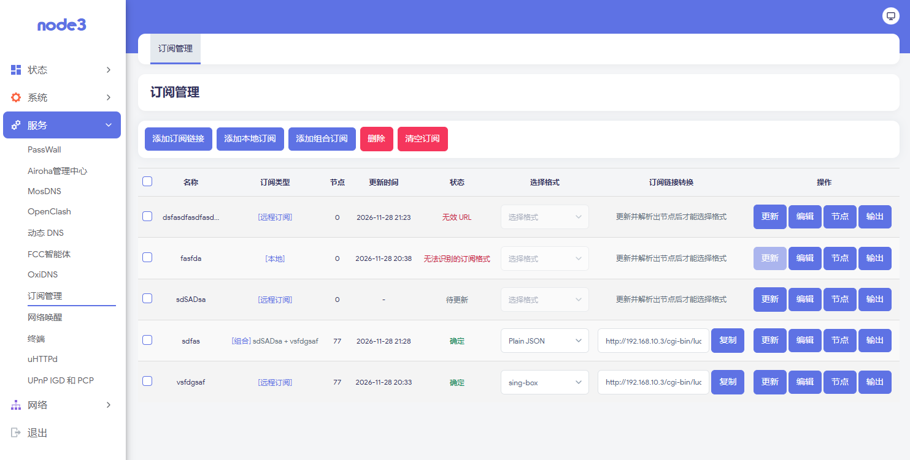

# luci-app-substore

**简体中文** | [English](README.en.md)

原生 **OpenWrt / ImmortalWrt** LuCI 应用，用于管理机场 / 代理订阅：解析订阅节点、
筛选、去重、重命名与分组，再转换为客户端可用的配置格式输出。

参考 [Sub-Store](https://github.com/sub-store-org/Sub-Store) 的功能与用户体验，
独立设计与实现：不使用 Docker，不依赖外部云端服务，资源占用友好，适配低配置路由器。



## 安装

> 包名中的版本号必须与 [Makefile](Makefile) 的 `PKG_VERSION` / `PKG_RELEASE` 保持一致
> （当前 `2.9.0-r1`）。

**最低支持 OpenWrt / ImmortalWrt 24.10**（更早的版本不在支持范围内）。
后端自 2.8.0 起整体为 ucode，不再依赖 Lua 运行时。

opkg（OpenWrt / ImmortalWrt 24.10）：

```bash
opkg install luci-app-substore_*.ipk
# 中文界面需额外安装翻译包
opkg install luci-i18n-substore-zh-cn_*.ipk
```

OpenWrt 25.12 及更新版本（apk）：

```bash
apk add --allow-untrusted luci-app-substore-*.apk
# 中文界面需额外安装翻译包
apk add --allow-untrusted luci-i18n-substore-zh-cn-*.apk
```

> 主包不含译文，未装翻译包时界面为英文。翻译包的版本号由 `po/` 目录的提交时间推导
> （LuCI 的 `PKG_PO_VERSION`），与主包不同名，按文件名通配安装即可。装好后 LuCI
> 语言设为「简体中文」即生效（该包的 uci-defaults 会自动把它加进 `luci.languages`）。

然后在 LuCI 菜单打开：**服务 → 订阅管理**。

### 从源码编译

在版本与目标固件匹配的 OpenWrt / ImmortalWrt 源码树中：

```sh
cd openwrt
./scripts/feeds update -a
./scripts/feeds install -a
git clone https://github.com/Arthur97172/luci-app-substore.git package/luci-app-substore
make menuconfig   # LuCI → Applications → luci-app-substore
make package/luci-app-substore/compile V=s
```

简体中文翻译包 `luci-i18n-substore-zh-cn` 由 `luci.mk` 按 `po/zh_Hans/` 自动生成，
与主包同属 `package/luci-app-substore` 目录，随同一条 `compile` 命令一并产出。但它是
HIDDEN 包（无 Kconfig prompt），编译前要显式打开语言符号，否则不会被选中：

```sh
echo "CONFIG_LUCI_LANG_zh_Hans=y" >> .config
make defconfig
```

> 注意**不存在** `make package/luci-i18n-substore-zh-cn/compile` 这个目标 —— make 的
> 目标按目录生成，不按包名。

`.ipk`（或 apk 构建下的 `.apk`）生成于 `bin/packages/.../` 下，按上面的方式安装即可。

## 功能特性

**订阅管理**
- 多订阅源的新增 / 编辑 / 删除 / 更新，支持手动更新与按订阅的定时（cron）更新；
  状态总览显示节点数、最近更新时间与错误信息
- **勾选批量删除**：勾选一条或多条订阅（表头选择框可全选）后点「删除」一次删掉；
  一条都没勾选时不会删除任何东西。列表行里不再单独放删除按钮，删除单个订阅
  就是「勾选它 + 点顶部删除」
- **清空订阅**：「删除」旁的「清空订阅」按钮在二次确认后删除全部订阅及其节点
  数据（含 cron 与组合来源的整理），列表为空时按钮置灰
- 每个订阅的剩余流量 / 剩余时长（解析 `subscription-userinfo` 响应头）
- **订阅代理**：经 `http` / `https` / `socks4` / `socks5` / `socks5h` 代理下载订阅，
  用于订阅源直连失败时
- **订阅客户端类型**：按订阅指定下载时发送的 `User-Agent`，内置 Clash Verge /
  v2rayN / Clash Party / FlClash 预设，也可自定义（直接填要原样发送的 UA 请求头，
  形如 `clash-verge/v2.5.0`，最长 256 字符、不含控制字符）。部分机场按 UA 下发节点 ——
  同一个链接只有用绑定的客户端才解析得出真实节点，用错会得到「与您使用客户端不兼容」
  的占位节点（能解析成功，但全是 `127.0.0.1:1080` 的假节点）
- **组合订阅**：把任意子集的现有订阅合并成一个新订阅，拥有独立名称、token 与订阅链接；
  源订阅更新或**被删除**后组合自动重算（删除时死 id 会从「来源」里摘掉，
  来源被删光则报错，而不是静默变成 0 节点）
- **本地订阅**：不填 URL，直接粘贴节点文本导入（一次一种格式，自动判定），
  或用表单按协议动态字段逐条录入节点

**输入解析**
- 订阅格式：URI 列表、Base64、JSON、Clash YAML、sing-box JSON、V2Ray / Xray JSON、
  Surge / Surfboard / Loon / Quantumult X 配置、wg-quick / AmneziaWG `.conf`
- 节点协议：`vmess` / `vless` / `trojan` / `shadowsocks` / `ssr` / `hysteria` /
  `hysteria2` / `tuic` / `wireguard` / `socks`
  （`http` 可导入并导出，但不在表单可选协议内）
- **WireGuard / AmneziaWG**：完整字段与 `amnezia-wg-option` 子块，
  可直接粘贴 AmneziaWG 客户端导出的 `.conf` 内容
- **解析容错**：缺 `server` 或端口不在 1–65535 的残缺节点在解析阶段即丢弃 ——
  否则会被写成客户端无法加载的配置，一个坏节点废掉整个订阅

**节点处理**
- 按分组 / 协议筛选、关键词搜索、排序；分组可在表格内直接修改（无刷新保存）
- 单节点编辑 / 删除，勾选后批量删除
- 按订阅规则：关键词包含 / 排除、协议筛选、去重、重命名（精确匹配 / 正则 / 占位符模板）

**网络探测**（节点页）
- Ping（ICMP）、TCPing（TCP 连接）、URL 测试（HTTP），并行探测并显示成功数与平均延迟。
  三者都是**从路由器直连探测节点服务器**，与 Clash Verge / OpenClash 显示的
  「经由代理访问 `generate_204`」的延迟不是同一指标，数字不可直接比较；
  指向 `127.0.0.1` 的占位假节点一律按失败处理（避免本机探测必然「成功」的假象）

**转换与输出**
- 15 种输出格式：Plain JSON、Stash、Clash.Meta / Mihomo、Clash 原版、Surfboard、Surge、
  Surge Mac、Loon、Egern、Shadowrocket、Quantumult X、sing-box、V2Ray / Xray、
  V2Ray URI、WireGuard / AmneziaWG `.conf`
- SSR（`ssr://`）只能原样输出到支持它的客户端（Mihomo、Stash、Loon、Shadowrocket），
  其余目标会将其丢弃；VLESS 同理，Surge / Surfboard / Surge Mac 的协议清单里没有它
  （Surge 家族与 Loon 的清单见 `output_formats.uc` 的 `FAMILY_CAPS`；
  Egern 的配置是 YAML，清单见 `output_egern.uc` 的 `EGERN_KEY` ——
  它有 VLESS 与 WireGuard，没有 SSR 与 Hysteria v1）
- **只输出目标客户端真正能加载的内容**：按目标能力过滤协议；数组字段按客户端要求的类型
  输出；策略组成员列表剔除会破坏语法的节点名
- sing-box / V2Ray(Xray) 输出**完整可用配置**（含分流规则），可直接作为单文件配置启动

**订阅链接**
- 每个订阅独立随机 token → 公开下载端点
  `/substore/download?token=<token>&target=<format>`，Passwall / OpenClash 等可直接拉取
- 列表页的格式下拉在订阅**解析出节点之前**（刚添加、更新失败、节点数为 0）
  置灰不可选，避免生成必然为空的订阅链接

**LuCI 界面与国际化**
- 后端整体为 ucode（控制器 / 模板 / 核心模块），与上游 LuCI 的运行时一致
- 自动跟随 LuCI 亮色 / 暗色主题，无需手动切换；适配 luci-theme-bootstrap
  （24.10 / 25.12 默认主题）与 luci-theme-argon 2.x / 3.x —— 颜色优先取主题的
  CSS 变量，缺失时用按亮/暗切换的兜底色，不写死单套配色
- 默认英文，运行时语言为 `zh-cn` 时自动显示简体中文

## 使用方法

1. **添加订阅** —— 粘贴订阅 URL；可选的按订阅 cron 定时、规则或下载代理。
   无订阅源时可「添加本地订阅」：粘贴节点文本或表单逐条录入。
2. **更新** —— 下载、解析并过滤节点。
3. **浏览节点** —— 筛选（分组 / 协议 / 关键词）、排序、探测延迟；勾选复选框后「删除」
   可批量删除，行内可编辑 / 删除 / 改分组，「刷新」重载列表。
4. **导出** —— 任选 15 种格式之一，或复制订阅链接供下游客户端（Passwall / OpenClash / …）使用。

> **重命名规则用的是 POSIX 扩展正则（ERE），不是 PCRE**。顶层和分组内的 `|`
> 都表示「或」，`a|b` 与 `(a|b)` 等价；`\d` / `\w` / `\s` 简写会翻译成对应的
> 字符类。ERE 没有非贪婪量词，`.*?` 会按贪婪的 `.*` 处理（不报错）；`\b` 会被
> 忽略；前后瞻等 PCRE 语法会编译失败，保存时直接拒绝并给出行号。字符类
> `[...]` 内的 `|` 仍是字面字符。

## 已知限制

以下均为**经代码级审计确认**的限制，是有意保留而非疏漏。

- **混合格式文本导入会被拒绝** —— 本地粘贴的节点文本一次只能是一种格式
  （URI / Base64 / YAML / JSON / WireGuard `.conf`），同一种格式内可混用协议。
  混用会**明确报错**并列出检出的格式，而不是静默丢掉一部分节点。
  **远程订阅不受此检查影响**：订阅内容若混用格式，仍按优先级取一种（与历史行为一致）。
- **hysteria v1 导出到 sing-box 需自行补 `up` / `down`（带宽）** —— 本项目的节点模型
  不承载带宽字段，凭空填默认值属于猜测，故不输出。
- **hysteria v1 的 URI 只保证「本包导出 → 本包导入」不失真** —— 上游 URI 规范
  （文档站点持续 404）未能核实，因此认不出的查询参数一律忽略，不臆造其语义。
- **`http` 协议不能在界面上手工新建** —— 权威协议表不含它，故表单不提供该选项；
  但它可由 Clash / JSON 配置导入，并能正常导出。
- **AmneziaWG 参数在界面上是一个 JSON 文本框**（`amnezia-wg-option`）—— 数据往返
  正确，但需手写 JSON。
- **wget 后端的体积与重定向检查发生在「请求发出之后」** —— busybox wget 没有
  `--max-filesize` / `--max-redirect` 的等价选项。超限响应体会被**丢弃并报错**
  （不会进入解析流程），重定向链也会**逐跳复检**、任一跳指向内网即整体拒绝；
  差别仅在于这两项检查晚于请求发出。**安装 curl 可完全避免**（curl 路径用
  `--max-filesize` 与 `--max-redirs 0` 在发出前拦截）。
- **本机完全没有 DNS 解析能力时，wget 后端会拒绝下载域名订阅** —— 这类设备上预检
  无法校验目标地址，而 wget 又没有 curl 的 `%{remote_ip}` 可用于「连接后复核」，
  按「校验不了就拒绝」处理（错误信息会提示安装 curl）。字面 IP 目标与有解析手段的
  设备不受影响。

## 目录结构

```
.
├── Makefile                      # OpenWrt 包定义
├── LICENSE                       # GPL-3.0-or-later
├── root/                         # 安装内容
│   ├── etc/
│   │   ├── config/substore       # UCI 占位
│   │   └── uci-defaults/99-substore
│   ├── usr/
│   │   ├── bin/substore-cron.sh  # 按订阅 cron 执行脚本（内联 ucode）
│   │   └── share/
│   │       ├── ucode/
│   │       │   ├── luci/controller/admin/substore.uc  # LuCI ucode 控制器
│   │       │   ├── luci/template/substore/*.ut        # 页面模板
│   │       │   └── substore/*.uc                      # 核心逻辑（不依赖 luci.*）
│   │       ├── luci/menu.d/luci-app-substore.json
│   │       └── rpcd/acl.d/luci-app-substore.json  # ACL 组（菜单 depends.acl 引用）
│   └── www/luci-static/resources/substore/nodeform.js # 节点表单前端脚本
└── po/zh_Hans/substore.po        # 简体中文翻译（编译为独立包 luci-i18n-substore-zh-cn）
```

## 更新日志

- [CHANGELOG.md](CHANGELOG.md) — 更新日志

设计与测试文档仅保留在本地开发目录，不随仓库发布，构建与安装均不依赖它们。

## 开发与测试

核心逻辑是 ucode 模块（`root/usr/share/ucode/substore/*.uc`），不依赖 `luci.*`，
可在设备上用 `ucode` 直接加载，cron 脚本就是同一个入口。仓库不发测试目录；
验证方式：

```sh
# 语法检查（设备上）：模块与控制器、模板
ucode -c -s /usr/share/ucode/substore/*.uc
ucode -T -c /usr/share/ucode/luci/template/substore/*.ut
# cron 主循环（更新全部已启用订阅）
/usr/bin/substore-cron.sh
```

功能验证在目标设备上逐页进行：订阅增删改、更新解析、节点筛选 / 编辑 / 探测、
15 种输出、订阅链接拉取、cron。

## 安全

SSRF 防护（拒绝内网 / 保留 / 链路本地地址；**有解析手段却解析不出即拒绝**，不给
「解析不出来就放行」留绕过口；重定向链**逐跳复检**）、协议白名单与端口范围校验
（1–65535）、响应体大小与超时限制、下载临时文件在每条退出路径上清理（`/tmp` 是
tmpfs）、命令注入防护（白名单解析 + shell 引用 + 探测目标拒绝以 `-` 开头的主机名）、
公开下载端点基于 token 的访问控制、日志不含凭据。

**无 DNS 解析能力的设备**（没有 `nslookup` 可执行文件）无法在下载前校验域名，
此时 curl 后端改用 `%{remote_ip}` 在**连接建立后**复核实际对端地址（同时关闭
DNS rebinding 的 TOCTOU 窗口）；wget 后端没有等价手段，**直接拒绝**而非放行
（见「已知限制」）。

**表单提交校验**：写操作要求 `token` 存在、非空，并在可取到时与 LuCI 的
`context.authtoken` 比对（这正是框架模板里 `token` 的取值来源）；校验失败会**回显
原因**，不会静默丢弃。**访问控制**：`luci-app-substore` ACL 组经 `menu.d` 的
`depends.acl` 生效 —— 未获授权的 LuCI 用户看不到本应用入口，**直接访问 URL 也会
被拒（403）**（依据：ucode dispatcher 在分发时校验路径上累积的 `depends.acl`，
已从上游源码核实，并**已在设备上实测通过**）。授权方式是把你希望可见的用户加入
`luci-app-substore` ACL 组（组定义见 `root/usr/share/rpcd/acl.d/luci-app-substore.json`）。

数据落盘权限：`/etc/substore` 目录 `0700`，`subscriptions.json` 与 `nodes/*.json`
`0600`（前者含订阅 URL 与公开下载 token，后者含 uuid / 密码 / 私钥）——
写文件按 umask 创建（通常 0644），同机任何用户都能读到，因此 `atomic_write`
写入后显式 `chmod` 收紧。

批量节点探测的并发上限为 16 个进程（`probe.MAX_PARALLEL`）：节点数由订阅内容决定，
不限并发会把路由器的 fd / 进程额度打满，之后 `popen` 静默失败。

## 许可证

[GPL-3.0-or-later](LICENSE) —— 见 [LICENSE](LICENSE) 文件。