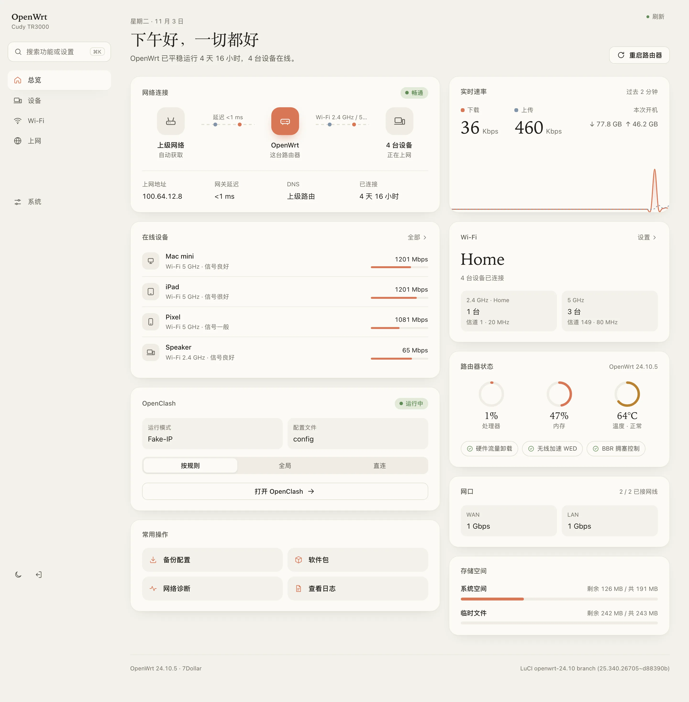
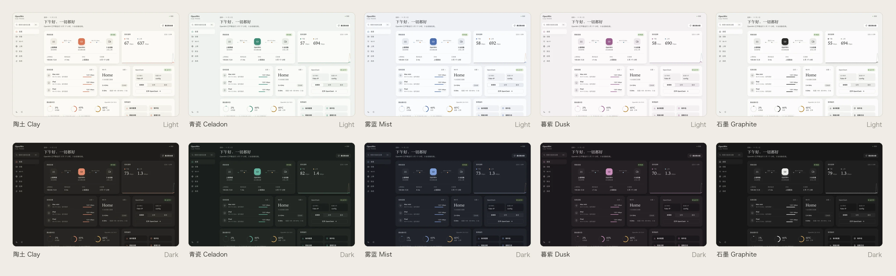
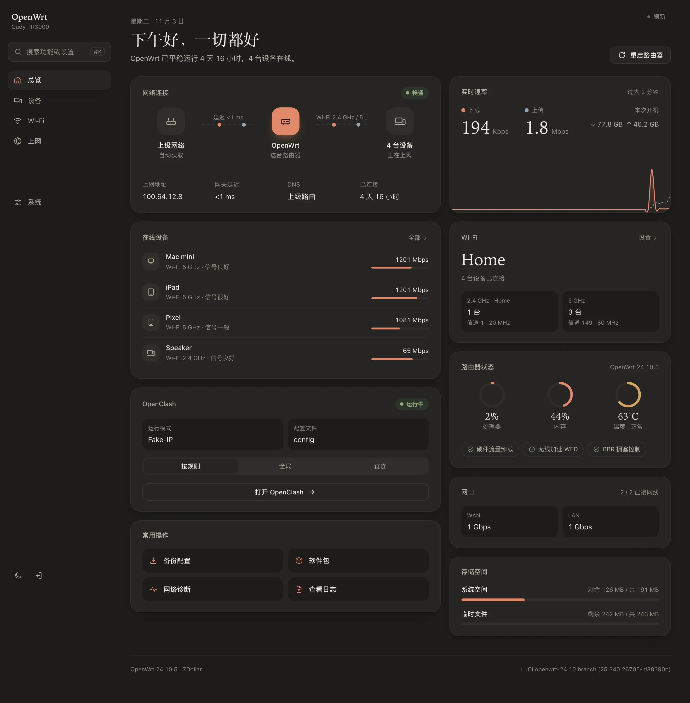
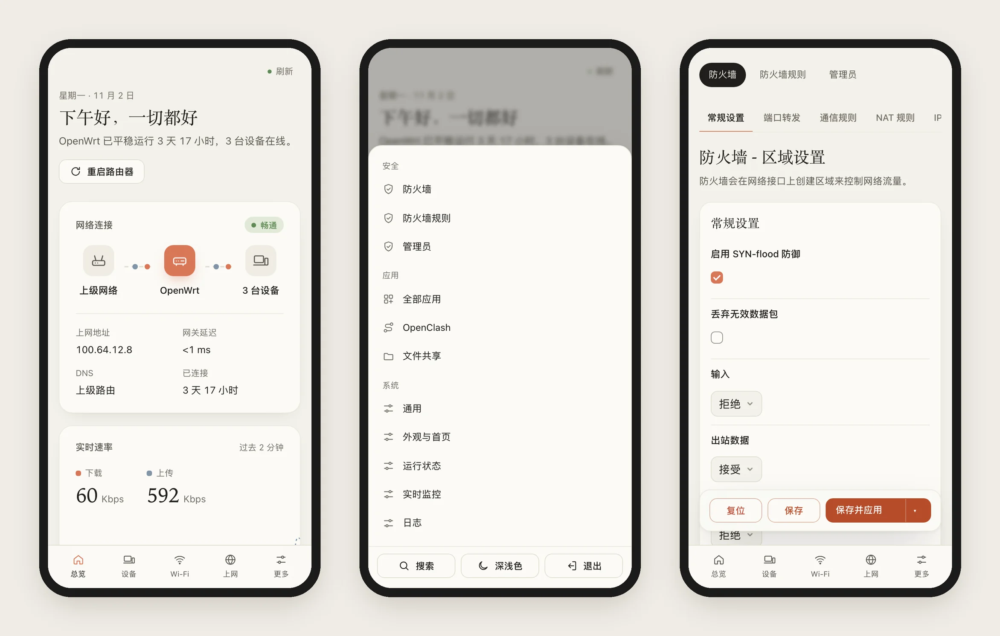
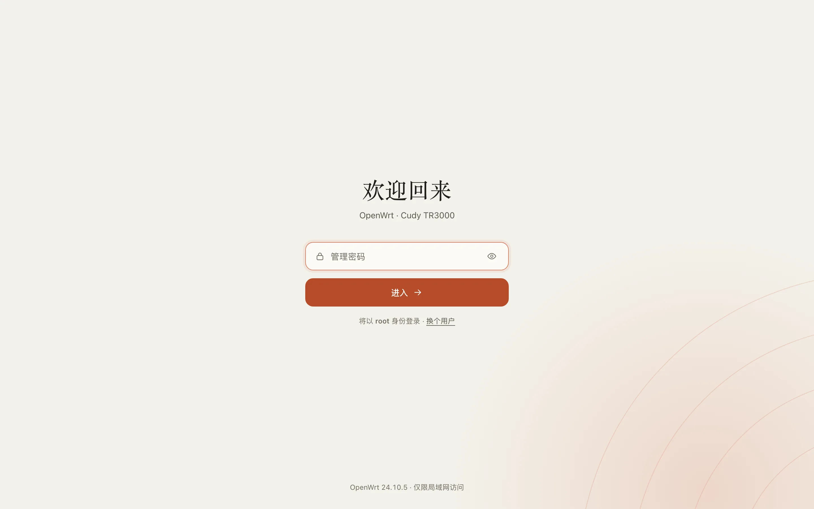
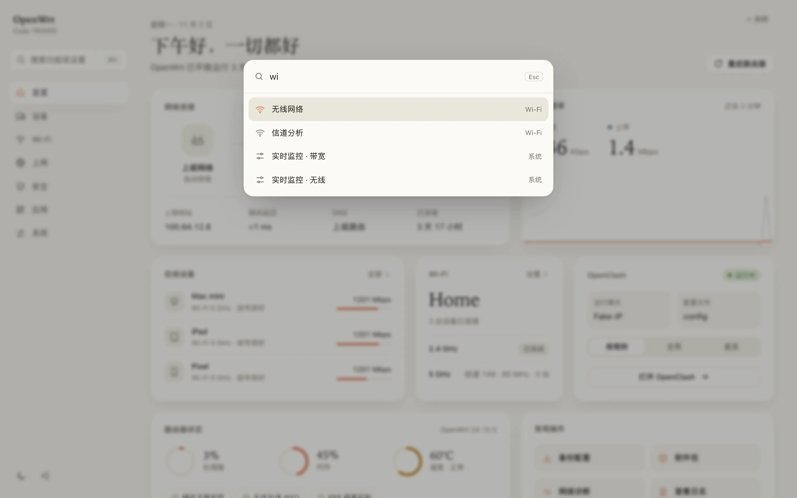
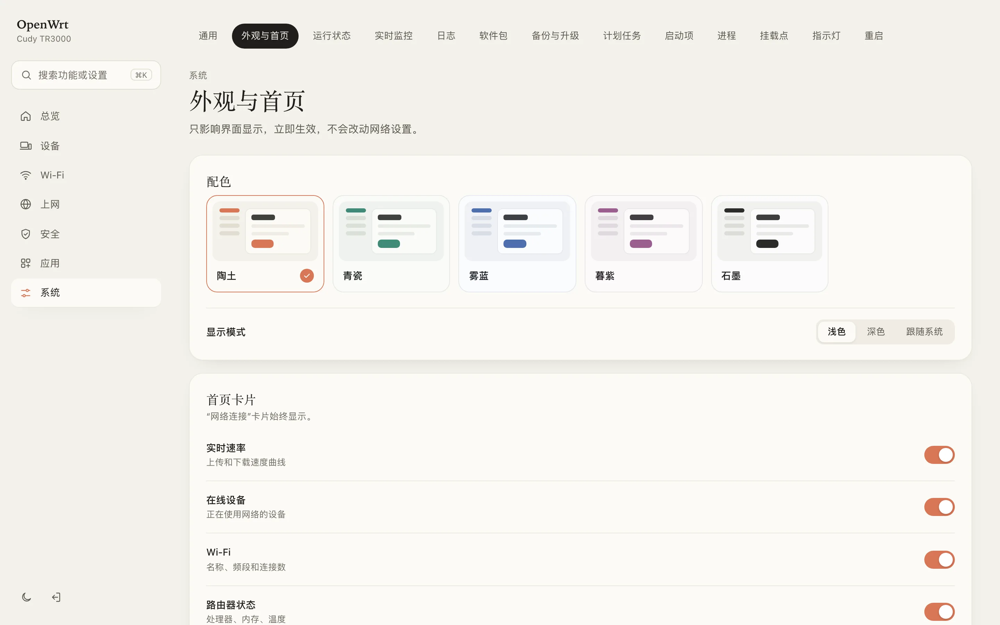
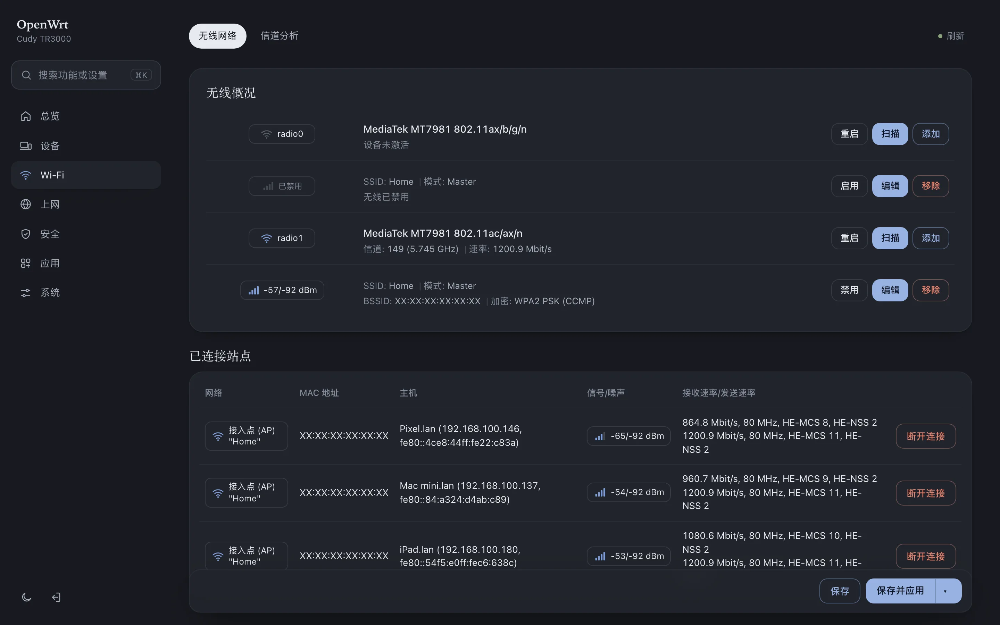

<p align="center">
  
</p>

<h1 align="center">7Dollar</h1>

<p align="center">
  不像工程师后台的 OpenWrt 主题<br>
  <sub>An OpenWrt theme that doesn't look like an engineer's console</sub>
</p>

<p align="center">
  
  
  
</p>

<p align="center">
  <a href="#安装">安装</a> · <a href="#使用">使用</a> · <a href="#卸载">卸载</a> · <a href="#english">English</a>
</p>

<p align="center">
  
</p>

## 简介

OpenWrt 的多数主题只调整了颜色，页面上仍是大量参数、表格和英文缩写，不熟悉网络的用户不容易看懂。7Dollar 重新组织了页面的呈现方式，让普通用户也能直接找到需要的信息和功能。

| | 常见主题 | 7Dollar |
| --- | --- | --- |
| 首页 | 参数表 | 网络状态、速率、在线设备集中显示 |
| 菜单 | 按技术模块分类：状态 / 系统 / 服务 / 网络 | 按使用场景分类：设备 / Wi‑Fi / 上网 / 安全 |
| 设备 | MAC 地址和 IP 列表 | 设备名称、类型、信号强度、连接时长 |
| 状态页 | 显示全部字段 | 默认显示常用信息，MAC、BSSID 等在「详情」中查看 |
| 用词 | 2g / 5g、DHCP 租约 | 2.4 GHz / 5 GHz、在线设备 |
| 查找功能 | 逐级打开菜单 | <kbd>⌘K</kbd> 搜索 |

LuCI 原有功能全部保留，只调整了显示方式。

## 名称由来

开发这个主题共花费了 **7 美元** 的 AI Token 费用，因此命名为 7Dollar。

## 功能

- **首页总览**：显示网络状态、实时速率、在线设备、Wi‑Fi、路由器状态、网口和存储空间。卡片可以单独开关，并自动分为两列排列
- **按用途分组的菜单**：总览 / 设备 / Wi‑Fi / 上网 / 安全 / 应用 / 系统，支持 <kbd>⌘K</kbd> / <kbd>Ctrl K</kbd> 搜索
- **5 套配色**：陶土、青瓷、雾蓝、暮紫、石墨，均有浅色和深色，可跟随系统设置
- **应用卡片（可选）**：默认关闭。开启后，首页列出正在运行的插件，适用于任意插件。常见插件会额外显示一项关键信息，例如 OpenClash 代理模式（可直接切换）、PassWall 当前节点、文件共享剩余空间。信息只从插件配置中读取，不调用插件接口
- **自适应布局**：在手机、平板和页面缩放时自动调整排版
- **轻量**：不加载外部字体，不发起外部请求；CSS 16 KB（gzip），安装包 48 KB
- **兼容原生页面**：LuCI 功能保持不变，原生图标统一为主题风格
- **信息分层**：Wi‑Fi、接口和状态页默认只显示常用信息，MAC、BSSID、数据包数等内容点击「详情」查看

## 截图

<p align="center"></p>

<table>
  <tr>
    <td width="50%"><p align="center"><sub>深色模式</sub></p></td>
    <td width="50%"><p align="center"><sub>手机</sub></p></td>
  </tr>
  <tr>
    <td width="50%"><p align="center"><sub>登录页</sub></p></td>
    <td width="50%"><p align="center"><sub>搜索</sub></p></td>
  </tr>
  <tr>
    <td width="50%"><p align="center"><sub>外观设置</sub></p></td>
    <td width="50%"><p align="center"><sub>原生页面</sub></p></td>
  </tr>
</table>

## 安装

安装前请确认路由器系统为 **OpenWrt 23.05 或更新版本**。版本号可在后台「状态 → 概览」中查看。

### 方法一：网页上传（推荐，无需命令行）

适用于 23.05 / 24.10。25.x 请使用方法二。

1. 下载安装包：[luci-theme-7dollar_1.0.16-r1_all.ipk](https://github.com/itsmaiGe/luci-theme-7dollar/releases/latest/download/luci-theme-7dollar_1.0.16-r1_all.ipk)（历史版本见 [Releases](https://github.com/itsmaiGe/luci-theme-7dollar/releases)）
2. 在浏览器中打开路由器后台（通常为 `192.168.1.1`），输入密码登录
3. 打开 **系统 → 软件包 → 上传软件包…**，选择下载的文件，点击 **上传**，再点击 **安装**
4. 刷新页面（Windows 按 <kbd>F5</kbd>，Mac 按 <kbd>⌘ R</kbd>）

> 如果刷新后界面没有变化：打开 **系统 → 系统 → 语言和界面**，将 **主题** 设为 **7Dollar**，点击 **保存并应用**。

### 方法二：一行命令

适用于所有支持的版本。脚本会根据系统自动选择 ipk（23.05 / 24.10）或 apk（25.x）安装包。

1. 打开终端：Mac 上搜索「终端」，Windows 上搜索「PowerShell」
2. 登录路由器（将 IP 替换为你的路由器地址）：

   ```sh
   ssh root@192.168.1.1
   ```

   首次连接出现 `yes/no` 提示时，输入 `yes` 并回车；然后输入路由器密码并回车。输入密码时屏幕不显示字符，这是正常现象。

3. 粘贴下面的命令并回车，出现「完成」后刷新浏览器：

   ```sh
   wget -qO- https://raw.githubusercontent.com/itsmaiGe/luci-theme-7dollar/main/install.sh | sh
   ```

<details>
<summary><b>下载失败</b></summary>

<br>

如果访问 GitHub 不稳定，建议使用方法一：先在电脑上下载安装包，再上传到路由器。

也可以使用 GitHub 加速代理（将 `<代理地址>` 替换为实际地址）：

```sh
wget -qO- <代理地址>/https://raw.githubusercontent.com/itsmaiGe/luci-theme-7dollar/main/install.sh | PROXY=<代理地址>/ sh
```
</details>

<details>
<summary><b>从源码编译</b></summary>

<br>

在 OpenWrt 源码或 SDK 中：

```sh
git clone https://github.com/itsmaiGe/luci-theme-7dollar.git feeds/luci/themes/luci-theme-7dollar
./scripts/feeds update -i && ./scripts/feeds install luci-theme-7dollar
make menuconfig   # LuCI → Themes → luci-theme-7dollar
make package/luci-theme-7dollar/compile V=s
```

不使用 SDK 时，可在 macOS / Linux 上运行 `./scripts/build-ipk.sh` 生成 ipk（需要 Node.js，打包时用 esbuild 压缩 JS / CSS，源码不变）；apk 由 GitHub Actions 在 OpenWrt 25.12 镜像中构建并测试安装（见 `.github/workflows/apk.yml`）。两者都输出到 `dist/`。
</details>

## 使用

| 操作 | 位置 |
| --- | --- |
| 切换配色 / 深浅色 | 系统 → 外观与首页（也可点击左下角 🌙 切换深浅色） |
| 调整首页卡片 | 系统 → 外观与首页 → 首页卡片 |
| 首页显示正在运行的插件 | 系统 → 外观与首页 → 首页卡片 → 应用 |
| 查看在线设备 | 侧边栏「设备」 |
| 搜索设置 | <kbd>⌘K</kbd> / <kbd>Ctrl K</kbd> / <kbd>/</kbd> |
| 打开已装插件 | 侧边栏「应用」 |

主题设置保存在 `/etc/config/7dollar`，只影响界面显示，不会修改网络配置。

## 卸载

- **切换为其他主题**：打开 系统 → 系统 → 语言和界面 → 主题，选择 Bootstrap 或其他主题，保存并应用
- **完全卸载**：打开 系统 → 软件包 → 已安装，搜索 `7dollar`，点击 **移除**。卸载后会自动切换为 Bootstrap
- **命令卸载**：

  ```sh
  wget -qO- https://raw.githubusercontent.com/itsmaiGe/luci-theme-7dollar/main/uninstall.sh | sh
  ```

<details>
<summary><b>后台无法打开时</b></summary>

<br>

通过 SSH 登录路由器后执行以下命令，切换为默认主题：

```sh
uci set luci.main.mediaurlbase=/luci-static/bootstrap && uci commit luci
```
</details>

## 兼容性

| | |
| --- | --- |
| OpenWrt | 23.05、24.10（ipk），25.x（apk）；不支持 22.03 及更早版本 |
| 浏览器 | Chrome / Edge 111+、Safari 16.4+、Firefox 113+（2023 年以后的版本） |
| 已测试 | Cudy TR3000 · OpenWrt 24.10.5 · MT7981B |
| 共存 | 可与 Bootstrap、Argon 等主题同时安装 |

## 目录结构

```
htdocs/luci-static/7dollar/      样式、图标
htdocs/luci-static/resources/    导航与页面脚本
ucode/                           页面框架、登录页
root/                            默认配置、菜单、权限
dist/                            ipk / apk 安装包
install.sh / uninstall.sh        安装 / 卸载脚本
```

## 致谢

- [OpenWrt LuCI](https://github.com/openwrt/luci)
- [zashboard](https://github.com/Zephyruso/zashboard)：多配色设计参考
- 默认配色参考 Claude 的橙色

## English

**7Dollar** is a LuCI theme for people who are not network engineers: it shows what matters (online or not, how fast, who's connected) instead of listing every field, groups menus by task (Devices, Wi‑Fi, Internet, Security), and keeps the technical details one *Details* click away. Nothing from LuCI is removed. It is a clean, card-based theme for OpenWrt 23.05+ (ucode LuCI), including apk-based 25.x. The name comes from its cost: **$7** in AI tokens.

- Home dashboard with connection status, live throughput, devices, Wi‑Fi and system health
- Menus grouped by purpose, with <kbd>⌘K</kbd> search
- 5 palettes (Clay, Celadon, Mist, Dusk, Graphite), each in light and dark
- Optional Apps card (off by default): lists whatever plugins are running. Popular ones get one line that matters (OpenClash proxy-mode switch, PassWall node, file-sharing free space…), read from their config, never from their API.
- Native LuCI pages restyled, icons included
- Status pages (Wi‑Fi, interfaces, overview) show the essentials; MACs, BSSIDs, packet counts and the like sit behind *Details*
- Responsive and zoom-friendly; no external fonts or requests; 48 KB package

**Install**: upload [the ipk](https://github.com/itsmaiGe/luci-theme-7dollar/releases/latest/download/luci-theme-7dollar_1.0.16-r1_all.ipk) via *System → Software → Upload Package* (23.05 / 24.10), or run over SSH on any version (picks the ipk or the [apk](https://github.com/itsmaiGe/luci-theme-7dollar/tree/main/dist) automatically):

```sh
wget -qO- https://raw.githubusercontent.com/itsmaiGe/luci-theme-7dollar/main/install.sh | sh
```

**Uninstall**: `opkg remove luci-theme-7dollar` / `apk del luci-theme-7dollar`, or the `uninstall.sh` one-liner.

## License

[Apache-2.0](LICENSE) © itsmaiGe
